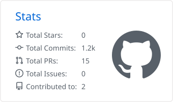
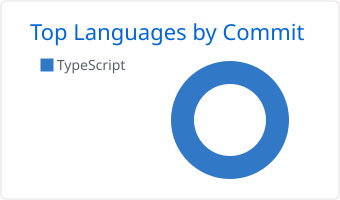

<h1 align="center">Shadab Ahmad</h1>

  <b>Cloud &amp; DevOps Engineer</b> 
  AWS Infrastructure &nbsp;|&nbsp; CI/CD Automation &nbsp;|&nbsp; Platform Reliability &nbsp;|&nbsp; Cloud-Native Architecture

  
  
  

---

## Profile

I design, build, deploy and operate cloud-native systems end to end. On AWS, I own the full delivery lifecycle for enterprise workloads: architecture, application development, infrastructure as code, CI/CD, containerized deployment, observability and security hardening.

A full-stack engineering foundation lets me work on both sides of the handoff between development and operations, which keeps feedback loops short and systems maintainable long after release.

---

## Delivery Lifecycle

| Stage | Focus |
|:--|:--|
| **Architect** | Reference architectures built for availability, fault tolerance and cost efficiency, using event-driven and queue-based designs that scale with demand. |
| **Develop** | Backend services, APIs and internal platforms written with deployment and operability in mind from the first commit. |
| **Provision** | Repeatable, version-controlled environments defined entirely as code. |
| **Deliver** | Automated build, test, scan, containerize and release pipelines with controlled promotion across environments. |
| **Operate** | Auto-scaling, runtime management, release coordination and root-cause troubleshooting across compute, network and application layers. |
| **Secure and Observe** | Vulnerability management, least-privilege access, metrics, logs and alerting built into every environment. |

---

## Technical Stack

#### Cloud &amp; Infrastructure as Code

&nbsp;AWS&nbsp;&nbsp;&nbsp;&nbsp;&nbsp;Terraform&nbsp;&nbsp;&nbsp;&nbsp;&nbsp;Ansible

AWS domains: Compute, Containers, Storage, Networking &amp; Content Delivery, Application Integration, Serverless, Security, Identity &amp; Compliance, Management &amp; Governance AWS CDK (TypeScript), AWS CloudFormation, Vagrant

#### Containers &amp; Orchestration

&nbsp;Docker&nbsp;&nbsp;&nbsp;&nbsp;&nbsp;Kubernetes

Docker Compose, Helm, Argo CD

#### CI/CD &amp; Release Engineering

&nbsp;Jenkins&nbsp;&nbsp;&nbsp;&nbsp;&nbsp;GitHub Actions&nbsp;&nbsp;&nbsp;&nbsp;&nbsp;Maven&nbsp;&nbsp;&nbsp;&nbsp;&nbsp;Git&nbsp;&nbsp;&nbsp;&nbsp;&nbsp;GitHub

SonarQube

#### Observability &amp; Security

&nbsp;Prometheus&nbsp;&nbsp;&nbsp;&nbsp;&nbsp;Grafana

Amazon CloudWatch, Amazon Inspector, AWS Security Hub, Amazon GuardDuty, AWS IAM, OpenTelemetry

#### Messaging, Streaming &amp; Data

&nbsp;Apache Kafka&nbsp;&nbsp;&nbsp;&nbsp;&nbsp;Redis&nbsp;&nbsp;&nbsp;&nbsp;&nbsp;PostgreSQL&nbsp;&nbsp;&nbsp;&nbsp;&nbsp;MongoDB

Amazon SQS

#### Systems &amp; Scripting

&nbsp;Linux&nbsp;&nbsp;&nbsp;&nbsp;&nbsp;Bash&nbsp;&nbsp;&nbsp;&nbsp;&nbsp;Python&nbsp;&nbsp;&nbsp;&nbsp;&nbsp;NGINX

DNS &amp; TCP/IP

#### Application Development

&nbsp;TypeScript&nbsp;&nbsp;&nbsp;&nbsp;&nbsp;JavaScript&nbsp;&nbsp;&nbsp;&nbsp;&nbsp;Node.js&nbsp;&nbsp;&nbsp;&nbsp;&nbsp;Express&nbsp;&nbsp;&nbsp;&nbsp;&nbsp;React&nbsp;&nbsp;&nbsp;&nbsp;&nbsp;Next.js&nbsp;&nbsp;&nbsp;&nbsp;&nbsp;Three.js

Socket.IO, REST APIs, GSAP

#### Applied AI &amp; Automation

LLM API Integration, ML Model Integration, Prompt Engineering, Workflow Automation

---

## GitHub Activity

  <picture>
    <source media="(prefers-color-scheme: dark)" srcset="./profile-summary-card-output/github_dark/3-stats.svg" />
    <source media="(prefers-color-scheme: light)" srcset="./profile-summary-card-output/github/3-stats.svg" />
    
  </picture>
  <picture>
    <source media="(prefers-color-scheme: dark)" srcset="./profile-summary-card-output/github_dark/2-most-commit-language.svg" />
    <source media="(prefers-color-scheme: light)" srcset="./profile-summary-card-output/github/2-most-commit-language.svg" />
    
  </picture>

  <picture>
    <source media="(prefers-color-scheme: dark)" srcset="https://streak-stats.demolab.com/?user=ahmad2shadab&hide_border=true&background=0D1117&ring=58A6FF&fire=58A6FF&currStreakLabel=58A6FF&sideLabels=8B949E&dates=6E7681&currStreakNum=F0F6FC&sideNums=F0F6FC" />
    <source media="(prefers-color-scheme: light)" srcset="https://streak-stats.demolab.com/?user=ahmad2shadab&hide_border=true&theme=default" />
    
  </picture>

  

